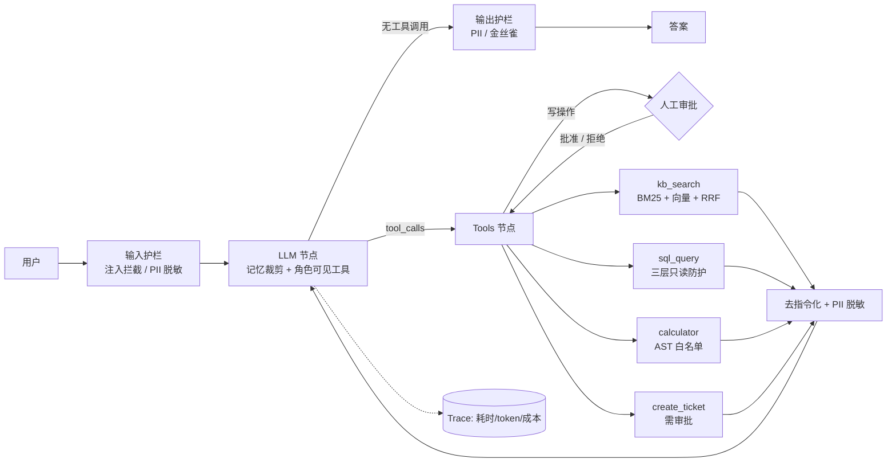

# AgentHub — 企业知识库 + 工具调用 Agent（Agentic RAG Copilot）

一个按当前 Agent 开发岗位 JD 高频要求设计的**可运行、可测试、可评测**的作品：
Function Calling Agent、混合检索 RAG、MCP Server、护栏与安全、人工审批（HITL）、链路追踪、离线评测。

> 核心代码**零第三方依赖**（纯标准库），`git clone` 后无需 API Key 即可跑通全部流程与测试。
> 配上任意 OpenAI 兼容接口（OpenAI / DeepSeek / 通义千问 / vLLM / Ollama）即可切换到真实模型。

## 为什么做这个项目（岗位需求 → 实现映射）

我检索了近期 Agent 开发岗位的 JD，高频要求集中在：LangGraph/LangChain 等编排、RAG + 向量库、MCP、FastAPI + Docker、护栏/安全/PII、评测与成本优化、多 Agent。对应实现：

| JD 高频要求 | 本项目实现 | 位置 |
|---|---|---|
| Agent 编排 / 状态机（LangGraph 类） | 显式 `llm → tools → llm → done` 状态机，可暂停/恢复，与 LangGraph StateGraph 一一对应 | `agenthub/agent.py` |
| Function Calling / Tool Schema / 结构化参数 | JSON Schema 声明 + 参数校验；校验失败的错误回灌模型自我纠正 | `tools/registry.py` |
| RAG + 检索策略 | 标题感知切块 → BM25 + 向量 → RRF 融合；可替换稠密 embedding | `agenthub/rag/` |
| MCP（Model Context Protocol） | 标准 stdio JSON-RPC MCP Server（initialize / tools/list / tools/call），仅暴露只读工具 | `agenthub/mcp_server.py` |
| 护栏 / 安全 / PII | 输入注入拦截、检索内容“去指令化”、PII 脱敏（进模型前 + 出模型后）、金丝雀泄露检测 | `agenthub/guardrails.py` |
| 工具权限 & 副作用控制 | 角色白名单（展示层 + 执行层双重校验）；写操作需人工审批 | `agent.py` |
| Text-to-SQL 安全 | 三层防护：正则策略 → SQLite authorizer（表/动作白名单）→ 只读连接 + 超时中断 + 行数上限 | `tools/builtin.py` |
| 上下文/记忆管理 | Token 预算裁剪，按“轮”裁剪，保证 tool_call 与 tool 结果不被拆开 | `agenthub/memory.py` |
| 可观测性 / 成本 | 每次请求一条 Trace：LLM/工具 span、耗时、token、成本 | `agenthub/tracing.py` |
| 评测（Evals） | 18 条用例，覆盖 RAG/SQL/多步/计算/HITL/安全；检索 hit@k；可作 CI 门禁 | `agenthub/evals/` |
| FastAPI + Docker + CI | `/v1/chat`、SSE 流式、`/v1/approve`；Dockerfile；GitHub Actions | `server.py` `Dockerfile` `.github/` |
| 稳定性 | LLM 请求指数退避重试、重复调用检测、最大步数 + 强制收敛、LLM 故障降级 | `llm/openai_compat.py` `agent.py` |

## 架构



## 快速开始

```bash
python -m agenthub ask "订单EC20250001签收了，我能申请七天无理由退货吗" --trace   # 多步：先查库再查政策
python -m agenthub chat                                                         # 交互式，写操作会请求确认
python -m unittest discover -s tests -t .                                       # 44 个测试
python -m agenthub eval --min-pass 0.9                                          # 评测（CI 门禁）
python -m agenthub mcp                                                          # MCP stdio 服务

pip install -e ".[server]" && python -m agenthub serve                          # HTTP API，:8000
docker build -t agenthub . && docker run -p 8000:8000 agenthub
```

接入真实模型（任意 OpenAI 兼容接口）：

```bash
export LLM_API_KEY=sk-... LLM_BASE_URL=https://api.deepseek.com/v1 LLM_MODEL=deepseek-chat
python -m agenthub eval        # 同一套评测直接跑真实模型，对比差异
```

MCP 客户端配置（如 Claude Desktop / Cursor）：

```json
{"mcpServers": {"agenthub": {"command": "python", "args": ["-m", "agenthub.mcp_server"], "cwd": "<repo>/agentic-rag-copilot"}}}
```

HTTP 示例（含审批流）：

```bash
curl -s localhost:8000/v1/chat -H 'content-type: application/json' -d '{"message":"紧急！支付系统宕机了，帮我创建一个工单"}'
# -> {"status":"awaiting_approval","pending_approvals":[{"id":"call_x","name":"create_ticket",...}],"session_id":"..."}
curl -s localhost:8000/v1/approve -H 'content-type: application/json' -d '{"session_id":"...","decisions":{"call_x":true}}'
```

## 评测结果（离线 mock 模型）

```
Pass: 18/18 (100%)   Retrieval hit@4: 1.0
By category: rag 8/8 · sql 2/2 · multi_step 1/1 · calculator 1/1 · hitl 2/2 · security 4/4
```

**请如实理解这个数字**：默认的 `MockLLM` 是规则式替身（按同样的 function-calling 协议发工具调用、再用工具结果拼答案），
用来验证**整条链路**（检索、工具、护栏、审批、追踪、API）和做 CI 回归，**不代表模型回答质量**。
评测集规模小（18 条）、语料小（5 篇文档）。真实模型的结果请用上面的方式自行跑并对比。

## 设计取舍与已知局限

* **自研状态机而非直接用 LangGraph**：为了让控制流、暂停恢复、失败处理透明可测；节点/边划分已与 LangGraph 对齐，迁移成本低。
* **默认 embedding 是哈希特征向量**（词面重叠，非语义），只为离线可跑；生产应配置 `EMBED_MODEL` 或换 bge-m3 + Qdrant/Milvus（`HybridRetriever` 只依赖 `embed()` 接口）。
* 检索没有相关度阈值：语料很小时 top-k 里会混入弱相关片段（真实 LLM 会忽略，但应加 reranker + 阈值）。
* 注入检测是启发式规则，**不能防住所有攻击**，只是纵深防御中的一层（其余：去指令化、权限白名单、审批、只读 SQL）。
* 会话存内存（LRU 上限 200），多实例部署需换 Redis/DB；尚未做鉴权与限流。
* 本项目环境的限制：FastAPI 层、Dockerfile 与真实模型调用未在作者的沙箱中实测（沙箱无网络/无这些依赖）。
  真实 HTTP 客户端用本地假服务端测过重试/解析；FastAPI 测试在装有 fastapi 时自动运行，CI 里会装依赖执行。

## Roadmap

多 Agent（Planner/Executor/Reviewer）· Reranker + 查询改写 · 语义缓存 · OpenTelemetry 导出 · LLM-as-judge 评测 · Redis 会话 · 鉴权/限流

## 目录

```
agenthub/  agent.py  memory.py  guardrails.py  tracing.py  mcp_server.py  server.py  service.py  cli.py
           llm/ (openai_compat, mock)   rag/ (chunker, bm25, embedder, retriever)
           tools/ (registry, builtin)   evals/ (runner, dataset.jsonl)
data/kb/   示例知识库（5 篇政策文档）     tests/   44 个测试     docs/INTERVIEW.md  面试讲解稿
```
